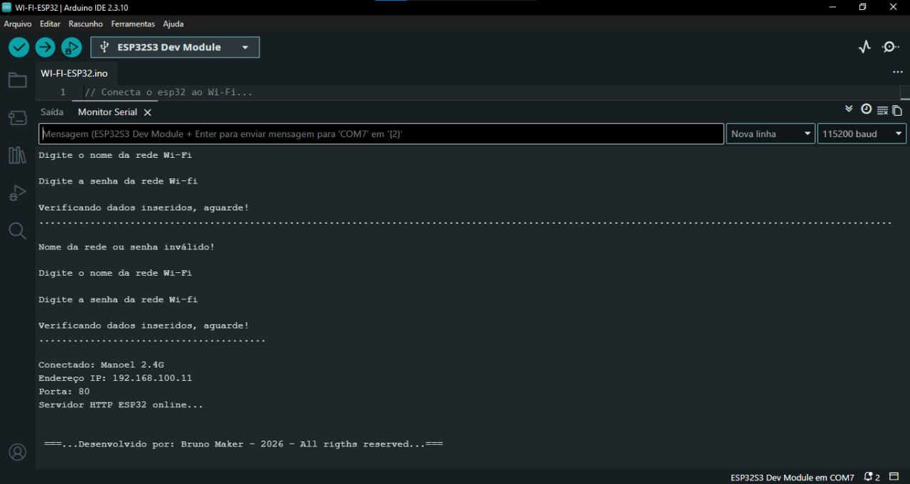

# WI-FI-ESP32

An Arduino IDE sketch that connects the ESP32 to a Wi-Fi network and starts a simple HTTP server. The network name and password are entered through the Serial Monitor, so they are not stored in the code.

[](WI-FI-ESP32-English.ino)
[](https://www.espressif.com/en/products/socs/esp32)
[](https://www.arduino.cc/en/software)
[](#)

## What it does

1. Asks for the Wi-Fi network name through the serial monitor.
2. Asks for the network password.
3. Tries to connect for up to 15 seconds (150 attempts of 100 ms each).
4. If it fails, it reports that the network name or password is invalid and asks for the credentials again.
5. If it connects, it shows the IP address and port in the monitor and starts the HTTP server.
6. When you open the IP address in a browser, the page "ESP32 Web Server Online" is displayed.

## Requirements

- ESP32 board (tested with ESP32-S3)
- Arduino IDE 2.3.10
- **esp32** board package (Espressif) installed
- **2.4 GHz** Wi-Fi network (the ESP32 does not connect to 5 GHz)

No extra libraries need to be installed. The sketch uses `WiFi.h`, `WiFiClient.h`, and `WebServer.h`, which are included with the board package.

## IDE setup

| Option | Value |
| --- | --- |
| Board | ESP32S3 Dev Module |
| USB CDC On Boot | **Enabled** |
| Monitor speed | 115200 baud |
| Line ending in the monitor | Newline |

> **Attention:** on the ESP32-S3, the Serial Monitor will show nothing if **USB CDC On Boot** is disabled. Enable this option under Tools before uploading.

## How to use

> **Attention:** the project folder must have the same name as the `.ino` file (`WI-FI-ESP32-English`). The Arduino IDE requires this, and it will show an error when opening the sketch if the names are different. The English sketch and this README are kept at the repository root; when using the sketch in the Arduino IDE, place it in a folder named `WI-FI-ESP32-English`.

1. Open `WI-FI-ESP32-English.ino` in the Arduino IDE.
2. Select the board and port under Tools.
3. Upload the sketch to the board.
4. Open the Serial Monitor at 115200 baud with the line ending set to **Newline**.
5. Enter the network name and press Enter.
6. Enter the password and press Enter.
7. When it connects, copy the displayed IP address and open it in a browser (on a phone or computer connected to the same network).

## Example output



### Invalid credentials

If the network name or password is wrong, the ESP32 waits for all 150 attempts, reports the error, and asks for the credentials again:

```
Enter the Wi-Fi network name

Enter the Wi-Fi password

Checking credentials, please wait!
......................................................................

Invalid network name or password!

Enter the Wi-Fi network name

Enter the Wi-Fi password
```

### Successful connection

```
Checking credentials, please wait!
..........................................

Connected: Manoel 2.4G
IP address: 192.168.100.11
Port: 80
ESP32 HTTP server online...
```

## Structure

The English files are kept at the repository root alongside the original Portuguese files:

```
├── WI-FI-ESP32.ino
├── README.md
├── WI-FI-ESP32-English.ino
├── README.en.md
└── imagens/
    └── print.jpg
```

## Author

Bruno Maker, 2026. All rights reserved.
