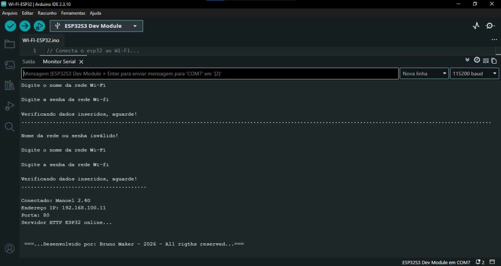

# WI-FI-ESP32

[](README.en.md)

Sketch para Arduino IDE que conecta o ESP32 a uma rede Wi-Fi e sobe um servidor HTTP simples. O nome e a senha da rede são digitados pelo Monitor Serial, então não ficam gravados no código.

[](WI-FI-ESP32.ino)

## O que ele faz

1. Pede o nome da rede Wi-Fi pela serial.
2. Pede a senha da rede.
3. Tenta conectar por até 15 segundos (150 tentativas de 100 ms).
4. Se falhar, avisa que o nome ou a senha são inválidos e pede os dados de novo.
5. Se conectar, mostra o IP e a porta no monitor e sobe o servidor HTTP.
6. Ao abrir o IP no navegador, a página "Servidor Web Server ESP32 Online" é exibida.

## Requisitos

- Placa ESP32 (testado com ESP32-S3)
- Arduino IDE 2.3.10
- Pacote de placas **esp32** (Espressif) instalado
- Rede Wi-Fi de **2.4 GHz** (o ESP32 não conecta em 5 GHz)

Não precisa instalar bibliotecas extras. O sketch usa `WiFi.h`, `WiFiClient.h` e `WebServer.h`, que já vêm com o pacote da placa.

## Configuração da IDE

| Opção | Valor |
| --- | --- |
| Placa | ESP32S3 Dev Module |
| USB CDC On Boot | **Enabled** |
| Velocidade do monitor | 115200 baud |
| Final de linha no monitor | Nova linha |

> **Atenção:** no ESP32-S3, com o **USB CDC On Boot** desativado, o Monitor Serial não mostra nada. Ative a opção em Ferramentas antes de gravar.

## Como usar

> **Atenção:** a pasta do projeto precisa ter o mesmo nome do arquivo `.ino` (`WI-FI-ESP32`). A Arduino IDE exige isso, e com nomes diferentes ela dá erro ao abrir o sketch.

1. Abra `WI-FI-ESP32.ino` na Arduino IDE.
2. Selecione a placa e a porta em Ferramentas.
3. Grave o sketch na placa.
4. Abra o Monitor Serial em 115200 baud com final de linha **Nova linha**.
5. Digite o nome da rede e aperte Enter.
6. Digite a senha e aperte Enter.
7. Quando conectar, copie o endereço IP mostrado e abra no navegador (celular ou computador na mesma rede).

## Exemplo de saída



### Credenciais inválidas

Se o nome da rede ou a senha estiverem errados, o ESP32 espera as 150 tentativas, avisa o erro e volta a pedir os dados:

```
Digite o nome da rede Wi-Fi

Digite a senha da rede Wi-fi

Verificando dados inseridos, aguarde!
......................................................................

Nome da rede ou senha inválido!

Digite o nome da rede Wi-Fi

Digite a senha da rede Wi-fi
```

### Conexão com sucesso

```
Verificando dados inseridos, aguarde!
..........................................

Conectado: Manoel 2.4G
Endereço IP: 192.168.100.11
Porta: 80
Servidor HTTP ESP32 online...
```

## Estrutura

```
├── WI-FI-ESP32.ino
├── README.md
└── imagens/
    └── print.jpg
```

🚀 Próximos projetos
Outros projetos serão postados em breve, com topologias diferentes e níveis de complexidade maiores.

👤 Autor: Bruno Zucker
